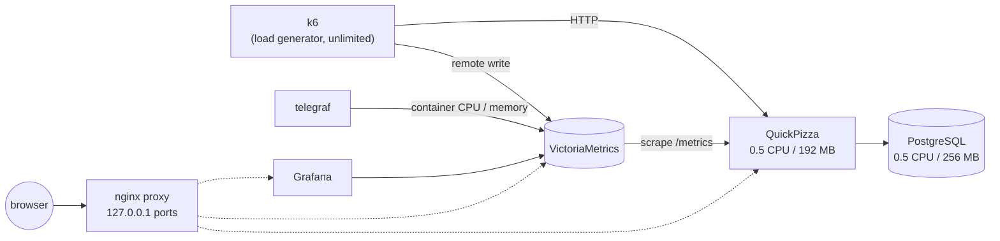

# Load Testing Workshop: k6 + Grafana + QuickPizza

A hands-on workshop on load testing with [k6](https://grafana.com/docs/k6/latest/).
Everything runs locally in Docker: a demo web app to break, a metrics stack to watch it break, and a set of progressive k6 tests.



| Component                                           | Role                                                       |
| --------------------------------------------------- | ---------------------------------------------------------- |
| [QuickPizza](https://github.com/grafana/quickpizza) | Demo app under test: pizza recommendations, users, ratings |
| PostgreSQL                                          | QuickPizza's database                                      |
| k6                                                  | Load generator; streams metrics to VictoriaMetrics         |
| VictoriaMetrics                                     | Prometheus-compatible metrics storage                      |
| telegraf                                            | Collects CPU / memory of every container                   |
| Grafana                                             | Dashboards: **k6 Prometheus** and **Docker Containers**    |
| nginx proxy                                         | Publishes the web UIs on `localhost`                       |

Every container except k6 has hard CPU and memory limits, so QuickPizza behaves like a small server with real hardware limits. k6 has no limits on purpose: the load generator must never be the bottleneck.

All containers run on an internal Docker network **without internet access**, so k6 cannot load-test a real website by mistake. Only the proxy is reachable from your machine.

## Quick start

Prerequisites: Docker Desktop (macOS / Windows) or Docker Engine + Compose plugin (Linux), with at least **2 CPUs and 3 GB RAM** given to Docker. See [docs/01-setup.md](docs/01-setup.md).

```shell
git clone <this repo> load-testing-workshop
cd load-testing-workshop

docker compose --profile k6 pull                        # do this before the workshop, on a good connection
docker compose up -d                                    # start QuickPizza + monitoring
docker compose run --rm --use-aliases k6 01-smoke.js    # run your first test
```

Then open:

| What                                       | URL                        |
| ------------------------------------------ | -------------------------- |
| QuickPizza                                 | http://localhost:3333      |
| Grafana (no login needed; admin / admin)   | http://localhost:3000      |
| k6 live dashboard (only while a test runs) | http://localhost:5665      |
| VictoriaMetrics UI                         | http://localhost:8428/vmui |

Each run gets a unique `testid` (e.g. `03-stress-20261009-153002`). Pick it in the **testid** selector of the _k6 Prometheus_ dashboard. An HTML report and a JSON summary land in `results/`.

## Tests

| Script               | Type           | Question it answers                                                      | Duration                    |
| -------------------- | -------------- | ------------------------------------------------------------------------ | --------------------------- |
| `01-smoke.js`        | Smoke          | Does the script work? Does the system respond correctly at minimal load? | 30 s                        |
| `02-average-load.js` | Average load   | Does the system meet its SLOs under typical traffic?                     | 5 min                       |
| `03-stress.js`       | Stress         | How does it degrade above normal load?                                   | 5 min                       |
| `04-spike.js`        | Spike          | Does it survive a sudden burst and recover?                              | 3 min                       |
| `05-soak.js`         | Soak           | Does it stay stable over time?                                           | 6 min (`-e DURATION=1h`)    |
| `06-breakpoint.js`   | Breakpoint     | Where exactly does it break?                                             | ≤ 10 min, aborts on failure |
| `07-scenarios.js`    | Mixed workload | Do different user types each meet their own SLO?                         | 3.5 min                     |

Run any of them the same way:

```shell
docker compose run --rm --use-aliases k6 03-stress.js
```

Add `-e DURATION_SCALE=0.1` for a dry run that is ten times shorter:

```shell
docker compose run --rm --use-aliases -e DURATION_SCALE=0.1 k6 03-stress.js
```

## Workshop guide

1. [Setup](docs/01-setup.md): install, start, verify, troubleshoot
2. [QuickPizza](docs/02-quickpizza.md): the app and the API the tests use
3. [k6 basics](docs/03-k6-basics.md): scripts, VUs, executors, checks, thresholds, scenarios
4. [Test types](docs/04-test-types.md): smoke, load, stress, spike, soak, breakpoint
5. [Observability](docs/05-observability.md): reading the dashboards
6. [Exercises](docs/06-exercises.md): hands-on tasks

## Stop and clean up

```shell
docker compose down      # stop, keep metrics and DB data
docker compose down -v   # stop and wipe all data
```

A `Makefile` with shortcuts (`make up`, `make test T=03-stress`, `make faults-on`, …) is included for macOS / Linux; `make up` also creates `.env` from `.env.example` if it does not exist. Plain `docker compose` commands work everywhere.

## License

[MIT](LICENSE)
